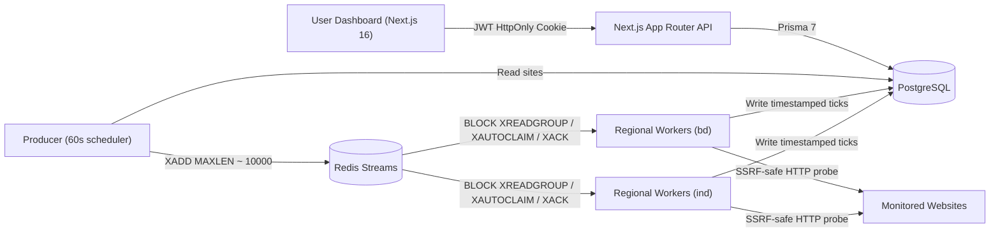

# Uptime — Event-Driven Multi-Region Website Monitor


**Uptime** is an event-driven, multi-region website availability and latency monitoring platform built with **Next.js 16**, **TypeScript**, **Redis Streams**, **Prisma 7**, and **PostgreSQL**. A scheduled producer dispatches monitoring jobs into a bounded Redis Stream, and isolated regional consumer-group workers probe endpoints with SSRF protection, automatic crash recovery (`XAUTOCLAIM`), and indexed time-series tick persistence.

---

## Architecture



---

## Key Features & Engineering Hardening

- **Event-Driven Producer/Worker Pipeline:** Decouples scheduled probes from the web app using **Redis Streams** with approximate `MAXLEN ~ 10000` stream trimming, overlap-safe scheduling, and graceful `SIGINT`/`SIGTERM` shutdown.
- **Fault-Tolerant Multi-Region Consumer Groups:** Dedicated Redis connections per blocking consumer (`BLOCK 5000`) across `bd` and `ind` regions, startup region seeding, periodic `XAUTOCLAIM` recovery for crashed workers' pending entries, and safe poison-message handling on deleted websites (`P2003`).
- **Defense-in-Depth Security & SSRF Protection:**
  - Salted `scrypt` password hashing with constant-time `timingSafeEqual` verification (`lib/password.ts`).
  - Expiring JWT `HttpOnly` cookies verified directly in API route handlers (`lib/auth.ts`) alongside Next.js 16 `proxy.ts` route protection.
  - Multi-layer SSRF guard (`lib/urlGuard.ts`) blocking non-HTTP(S) schemes, credentials, localhost/internal hosts, private/link-local/metadata IP ranges, DNS-rebinding lookups, and unsafe redirect hops.
- **Real-Time Monitoring Dashboard & API:** Landing page, Sign Up/Sign In flows, live uptime %, average latency, per-region heartbeat bars, auto-refresh, endpoint deletion (`DELETE /api/websites/[id]`), and `/api/health` readiness endpoint.
- **Containerized Stack, Tests & CI/CD:** Multi-stage `Dockerfile`, `docker-compose.yml` with automatic `prisma migrate deploy` init service, automated unit tests (`bun run test`), and GitHub Actions CI (typecheck, lint, tests, Next.js build, Docker image build).

---

## Tech Stack

| Layer | Technology |
| :--- | :--- |
| **Web & API** | Next.js 16 (App Router + `proxy.ts`), React 19, TypeScript 5, Tailwind CSS v4 |
| **Message Broker** | Redis Streams (`redis` client, Consumer Groups, `XAUTOCLAIM`, `MAXLEN`) |
| **Database & ORM** | PostgreSQL 16, Prisma 7 (`@prisma/adapter-pg`, indexed time-series ticks) |
| **Security & Auth** | `node:crypto` `scrypt` + `timingSafeEqual`, JWT `HttpOnly` cookies, DNS-aware SSRF guard |
| **Runtime & DevOps** | Bun, Docker, Docker Compose, GitHub Actions CI |

---

## Getting Started

### Option A: Run Everything with Docker Compose

```bash
git clone https://github.com/M-U-Rony/uptime.git
cd uptime
cp .env.example .env
docker compose up --build
```

The `migrate` service automatically runs `prisma migrate deploy` before `web`, `producer`, and `worker` start, and `worker` automatically seeds the `bd` and `ind` regions on startup.

Open [http://localhost:3000](http://localhost:3000).

### Option B: Local Development

```bash
git clone https://github.com/M-U-Rony/uptime.git
cd uptime
cp .env.example .env

# Install dependencies
bun install
cd redis && bun install && cd ..

# Generate Prisma client & apply migrations
bunx prisma generate
bunx prisma migrate deploy

# Run unit tests
bun run test

# Terminal 1 — Next.js web app
bun run dev

# Terminal 2 — Job producer
bun run producer.ts

# Terminal 3 — Multi-region worker
bun run worker.ts
```

---

## Project Structure

```text
├── .github/workflows/ci.yml   # GitHub Actions CI (typecheck, lint, tests, build, Docker)
├── app/
│   ├── api/
│   │   ├── signup / signin / signout  # Scrypt + JWT HttpOnly cookie authentication
│   │   ├── createWebsite/             # SSRF-validated monitor registration
│   │   ├── getAllWebsites/            # Websites with recent ticks & uptime metrics
│   │   ├── websites/[id]/             # Owner-scoped monitor deletion
│   │   └── health/                    # Database readiness healthcheck
│   ├── signin / signup / dashboard/   # Auth & live monitoring dashboard pages
│   └── page.tsx                       # Landing page
├── components/                # Landing, AuthForm, and Dashboard client components
├── lib/
│   ├── auth.ts                # JWT sign/verify & cookie helpers
│   ├── password.ts            # Salted scrypt hashing & timingSafeEqual verification
│   ├── urlGuard.ts            # URL validation & DNS-aware SSRF protection
│   └── metrics.ts             # Uptime % and latency summary calculation
├── prisma/
│   ├── schema.prisma          # User, Website, Region, WebsiteTicks models + indexes
│   └── migrations/            # PostgreSQL SQL migrations
├── redis/
│   ├── connection.ts          # Per-consumer Redis client factory & reconnect strategy
│   └── index.ts               # Bounded XADD stream producer helper
├── tests/run.ts               # Automated unit tests for auth, SSRF guard & metrics
├── producer.ts                # Overlap-safe 60s scheduler with graceful shutdown
├── worker.ts                  # Blocking multi-region consumer group worker + XAUTOCLAIM
├── proxy.ts                   # Next.js 16 route & API protection
├── Dockerfile                 # Multi-stage Bun production image
└── docker-compose.yml         # Postgres + Redis + Migrate + Web + Producer + Worker
```

---

## License

This project is open-source and available under the [MIT License](LICENSE).
