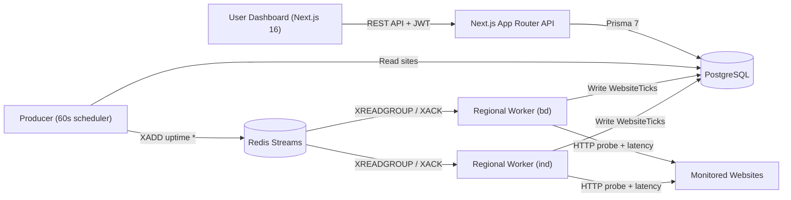

# Uptime — Event-Driven Multi-Region Website Monitor


**Uptime** is an event-driven, multi-region website availability and latency monitoring platform built with **Next.js 16**, **TypeScript**, **Redis Streams**, **Prisma 7**, and **PostgreSQL**. A scheduled producer dispatches monitoring jobs into a Redis Stream, and regional consumer-group workers probe endpoints in parallel and persist response times and status ticks.

---

## Architecture



---

## Key Features

- **Event-Driven Producer/Worker Pipeline:** Decouples scheduled health checks from the web app using **Redis Streams** (`XADD`, `XREADGROUP`, `XACK`) for reliable message delivery.
- **Multi-Region Consumer Groups:** Independent regional workers (`bd`, `ind`) probe monitored URLs with a 5-second `AbortSignal.timeout` and record per-region status (`up`/`down`) and latency (`res_time_ms`).
- **Real-Time Monitoring Dashboard:** Clean Next.js 16 + React 19 UI to register websites and track availability history per user.
- **JWT Cookie Authentication:** HTTP-only cookie-based authentication (`/api/signup`, `/api/signin`) protecting user websites and dashboard routes.
- **Containerized Stack & CI/CD:** Multi-stage `Dockerfile`, full `docker-compose.yml` (PostgreSQL, Redis, Web, Producer, Worker), and GitHub Actions CI pipeline (typecheck, Next.js build, Docker image build).

---

## Tech Stack

| Layer | Technology |
| :--- | :--- |
| **Web & API** | Next.js 16 (App Router), React 19, TypeScript 5, Tailwind CSS v4 |
| **Message Broker** | Redis Streams (`redis` client, Consumer Groups) |
| **Database & ORM** | PostgreSQL 16, Prisma 7 (`@prisma/adapter-pg`) |
| **Authentication** | JSON Web Tokens (`jsonwebtoken`, HTTP-only cookies) |
| **Runtime & DevOps** | Bun, Docker, Docker Compose, GitHub Actions CI |

---

## Getting Started

### Prerequisites

- [Bun](https://bun.sh/) (or Node.js 20+)
- PostgreSQL 16 & Redis 7 (or Docker Desktop)

### Option A: Run Everything with Docker Compose

```bash
git clone https://github.com/M-U-Rony/uptime.git
cd uptime
cp .env.example .env
docker compose up --build
```

Push the database schema once PostgreSQL is healthy:

```bash
bunx prisma db push
```

Open [http://localhost:3000](http://localhost:3000).

### Option B: Local Development

```bash
git clone https://github.com/M-U-Rony/uptime.git
cd uptime
cp .env.example .env

# Install dependencies
bun install
cd redis && bun install && cd ..

# Generate Prisma client & push schema
bunx prisma generate
bunx prisma db push

# Terminal 1 — Next.js web app
bun run dev

# Terminal 2 — Job producer
bun run producer.ts

# Terminal 3 — Multi-region worker
bun run worker.ts
```

---

## Project Structure

```text
├── .github/workflows/ci.yml   # GitHub Actions CI (typecheck, Next.js build, Docker build)
├── app/
│   ├── api/
│   │   ├── signup/            # User registration
│   │   ├── signin/            # JWT login & HTTP-only cookie
│   │   ├── createWebsite/     # Register a URL for monitoring
│   │   └── getAllWebsites/    # Fetch user websites & ticks
│   ├── dashboard/             # Authenticated uptime dashboard
│   └── page.tsx               # Landing page
├── components/                # Dashboard & landing UI components
├── prisma/
│   ├── schema.prisma          # User, Website, Region, WebsiteTicks models
│   └── migrations/            # PostgreSQL migrations
├── redis/
│   ├── connection.ts          # Redis client (REDIS_URL-aware)
│   └── index.ts               # XADD stream producer helper
├── producer.ts                # 60s interval job scheduler
├── worker.ts                  # Multi-region Redis Consumer Group worker
├── Dockerfile                 # Multi-stage Bun production image
└── docker-compose.yml         # Postgres + Redis + Web + Producer + Worker
```

---

## License

This project is open-source and available under the [MIT License](LICENSE).
